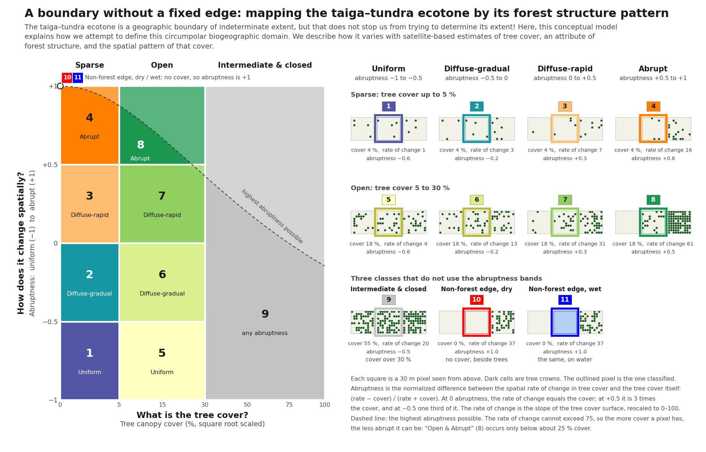
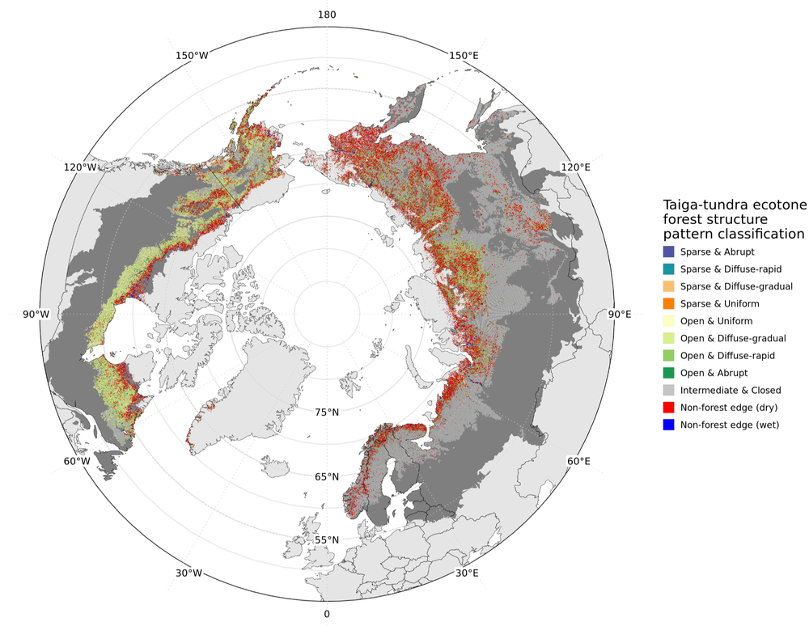

# Taiga-tundra ecotone (TTE) forest structure pattern mapping  



This mapping of TTE pattern uses maps of tree canopy cover across the boreal-tundra ecological transition zone. It is built off of the calculation of tree cover "abruptness", which is the normalized difference between the spatial rate of change in tree canopy cover and the tree canopy cover itself, from −1 (uniform) to +1 (abrupt).



Reproducibity & scalability (on NASA MAAP) of the original Google Earth Engine (GEE) workflow using Python 
`projects/foreststructure/TTE_DATA_v201902v2` (circa 2010) and runs on MAAP DPS with any
tree canopy cover (TCC) input.

> Montesano, P.M., Neigh, C.S.R., Macander, M., Feng, M., Noojipady, P. (2020).
> The bioclimatic extent and pattern of the cold edge of the boreal forest: the circumpolar
> taiga-tundra ecotone. *Environ. Res. Lett.* 15, 105019. https://doi.org/10.1088/1748-9326/abb2c7

| Component | Location |
|---|---|
| Core code + command line | `lib/tte_map.py` |
| DPS algorithm `run_tte_map` | `dps/alg_tte_map/` (run.sh, build.sh, env.yml, algorithm_config.yml) |
| DPS register / submit notebook | `dps/DPS_tte_map.ipynb` |
| Comparison with the GEE tiles | `validation/validate_tte_vs_gee.py` |
| Original GEE scripts | `gee/` |

## Methods for reproducing original GEE workflow

For each 1-degree tile (`tte_tiles.gpkg`, same tiles as the GEE download):

1. **Grid.** Work on the original grid: north polar Lambert azimuthal equal area
   (lat_0 90, lon_0 0, WGS84), 30 m, aligned to the GEE asset. The abruptness is a slope,
   so it depends on the grid; computing in lon/lat would change it.
2. **Domain.** Keep the TTE domain: where mean temperature of the warmest quarter is 7-14 °C
   (WorldClim bio_10), inside the WWF taiga and tundra ecoregions (biome 10 excluded), on land
   (Feng et al. water mask). This is a fixed layer, read from the `tte_domain` band of the GEE tiles.
3. **Tree cover.** Read TCC (percent) into the grid from any source registered in
   `lib/tte_tcc_sources.py` (`--tcc_source`, `--tcc_year`, `--tcc_options`; list them with
   `python lib/tte_map.py --list_sources`). The GEE map used Hansen GFC 2018 v1.6 `treecover2000`
   set to 0 where `lossyear` is 2001-2009 ("Hansen 2010") in Eurasia, and calibrated 2 m TCC
   (`cal_2m_tcc`) in North America.
4. **Water.** Where JRC Global Surface Water occurrence >= 1, set TCC to 0 (inside or outside
   the domain). Forest next to water then gets an abrupt edge.
5. **Rate of change.** Slope of TCC in degrees from the 4 neighbours (as `ee.Terrain.slope`),
   rescaled 0-90 to 0-100.
6. **Abruptness** = (rate - TCC) / (rate + TCC), from -1 (uniform) to 1 (abrupt).
7. **Mask.** Keep domain pixels where abruptness is not 0. This drops large areas of TCC 0
   with no change. TCC 0 with abruptness 1 is the non-forest edge.
8. **Zones** by TCC: sparse (<= 5), open (6-30), intermediate and closed (> 30).
9. **Classes** from zone x abruptness:

| Value | Class | Rule |
|---|---|---|
| 1 | Sparse & Uniform | TCC 0-5, abruptness <= -0.5 |
| 2 | Sparse & Diffuse-gradual | TCC 0-5, -0.5 to 0 |
| 3 | Sparse & Diffuse-rapid | TCC 0-5, 0 to 0.5 |
| 4 | Sparse & Abrupt | TCC 0-5, 0.5 to < 1 |
| 5 | Open & Uniform | TCC 6-30, <= -0.5 |
| 6 | Open & Diffuse-gradual | TCC 6-30, -0.5 to 0 |
| 7 | Open & Diffuse-rapid | TCC 6-30, 0 to 0.5 |
| 8 | Open & Abrupt | TCC 6-30, > 0.5 |
| 9 | Intermediate & Closed | TCC > 30 |
| 10 | Non-forest edge (dry) | TCC 0, abruptness 1 |
| 11 | Non-forest edge (wet) | TCC 0, abruptness 1, on GSW water |

Output: one COG per tile, `tte_<source>_<tile_num 7 digits>.tif`, float32, NaN = no data,
5 bands with the GEE names: `tte_domain`, `tte_zones`, `tte_abruptness`,
`tte_classification`, `tcc`. Pixels outside the 1-degree tile are NaN, so tiles mosaic
without double counting. Class names are in the band 4 tags.

## Validation against the original TTE map tiles

Differences: mainly just due to resampling of data coming out of GEE

`validation/validation.md`: 13 tiles. Eurasia (Hansen in both) 90-94% same class; North America
differs because GEE used `cal_2m_tcc` there.

## Run examples

```bash
# the tree cover sources and their options
python lib/tte_map.py --list_sources

# one tile with the tree cover the GEE map used in Eurasia (Hansen 2010, GFC 2018 v1.6)
python lib/tte_map.py --tile_num 4082 --outdir /tmp/tte --tcc_source hansen --tcc_year 2010 \
    --tcc_options "version=GFC-2018-v1.6"

# Meta/WRI canopy height v2: percent of ~1 m pixels >= 2 m, nominal year 2020
python lib/tte_map.py --tile_num 4082 --outdir /tmp/tte --tcc_source meta_chm --tcc_year 2020 \
    --tcc_options "version=v2;ht_min=2"

# your own percent cover rasters (any CRS), with TCC below 5 % set to 0
python lib/tte_map.py --tile_num 4082 --outdir /tmp/tte --tcc_source path --tcc_year 2020 \
    --tcc_paths s3://bucket/my_tcc_2020.vrt --tcc_options "resampling=average;floor=5" --out_name mytcc2020
```

## Scaling with MAAP DPS for any TCC input

On DPS: `dps/DPS_tte_map.ipynb`.
